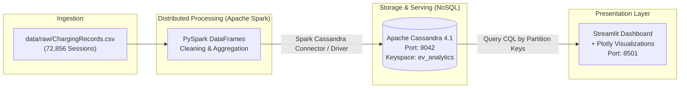

# Electric Vehicle (EV) Charging Station Analytics

[](#)
[](#)
[](#)
[](#)
[](#)

A complete Big Data Analysis laboratory project demonstrating end-to-end distributed data processing, NoSQL persistence, and interactive business intelligence on real-world electric vehicle charging transactions.

---

## 1. Project Objective

The primary objective of this project is to analyze charging behavior, station utilization, and power grid demand patterns using distributed computing and scalable NoSQL database storage.

- **Data Pipeline**: Ingestion and transformation of 72,856 real-world EV charging transaction sessions.
- **Distributed Computing**: Apache Spark (PySpark) for distributed data cleaning, timestamp parsing, outlier filtering, and analytical metric aggregation.
- **NoSQL Persistence**: Apache Cassandra for query-driven time-series and aggregated metric storage, leveraging partition keys for constant-time lookups.
- **Interactive Visualization**: Streamlit and Plotly dashboard providing interactive station utilization, hourly grid load heatmaps, and charger efficiency reports.

---

## 2. Architecture



### High-Level Data Flow:
1. **Raw Ingestion**: Real-world transaction logs collected over one annual commercial operating period.
2. **Distributed Processing**: PySpark parses timestamps, cleans anomalous durations, calculates session kilowatt throughput, and computes aggregations (hourly grid load, AC vs. DC charger utilization, location efficiency).
3. **Optimized Cassandra Modeling**: Cassandra tables designed around specific query access patterns (partitioned by charger, date, and location) rather than relational normalization.
4. **Interactive Dashboard**: Streamlit queries pre-aggregated analytical tables from Cassandra to deliver sub-second visual responses.

---

## 3. Project Directory Structure

```text
.
├── cassandra/
│   └── init-scripts/          # CQL schema initialization files
├── data/
│   ├── raw/                   # Raw immutable datasets (e.g., ChargingRecords.csv)
│   └── processed/             # Cleaned Parquet / intermediary data
├── docs/
│   └── dataset_spec.md        # Comprehensive dataset documentation and schema
├── scripts/
│   ├── check_env.py           # Environment, runtime, and directory verification script
│   └── check_cassandra.py     # Cassandra TCP and CQL connectivity verification script
├── src/
│   ├── analytics/             # PySpark transformation and aggregation jobs
│   ├── database/              # Cassandra connection management and CQL data access layer
│   └── dashboard/             # Streamlit visual application components
├── tests/
│   └── test_scaffold.py       # Unit tests verifying project structure and configuration
├── .env.example               # Configuration template (copy to .env for local adjustments)
├── .gitignore                 # Rules for excluding secrets, caches, and datasets
├── docker-compose.yml         # Containerized single-node Apache Cassandra 4.1 service
├── README.md                  # Project documentation and guide
└── requirements.txt           # Pinned, tested Python dependency specification
```

---

## 4. Prerequisites

| Tool | Recommended Version | Verification Command | Notes |
| :--- | :--- | :--- | :--- |
| **Python** | 3.11.x | `python --version` or `py -3.11 --version` | Required for binary compatibility with PySpark and compiled wheels. |
| **Java (JDK)** | Java 8, 11, or 17 | `java -version` | Required by PySpark. Ensure `JAVA_HOME` is set. |
| **Docker** | 20.10+ | `docker --version` | Docker Desktop running with Linux containers (WSL2 backend on Windows). |
| **Docker Compose** | v2.0+ | `docker compose version` | Standard Compose CLI plugin. |

---

## 5. Setup & Getting Started

### Step 1: Clone and Configure Environment
1. Clone this repository or open the project folder in your terminal.
2. Create local configuration file from the template:
   ```powershell
   Copy-Item .env.example .env
   ```

### Step 2: Set Up Python Virtual Environment
We strongly recommend creating a virtual environment with **Python 3.11**:
```powershell
# Create virtual environment
py -3.11 -m venv .venv

# Activate virtual environment (Windows PowerShell)
.\.venv\Scripts\Activate.ps1

# Upgrade pip
python -m pip install --upgrade pip

# Install pinned dependencies
pip install -r requirements.txt
```

### Step 3: Start Apache Cassandra Service
Start the single-node Cassandra instance in the background using Docker Compose:
```powershell
# Start container
docker compose up -d

# Check status and healthcheck progress
docker compose ps
```
> **Note**: Cassandra performs JVM memory initialization and gossip ring bootstrap. The container healthcheck will transition from `(health: starting)` to `(healthy)` within ~30 to 45 seconds.

### Step 4: Run Verification Checks & ETL Pipeline
```powershell
# 1. Verify environment
python scripts/check_env.py

# 2. Verify Cassandra TCP & CQL connectivity
python scripts/check_cassandra.py

# 3. Run all unit tests
pytest tests/

# 4. Execute the complete PySpark ETL pipeline
python scripts/run_etl.py
```

### Step 5: Load and Verify Cassandra Storage (Phase 3)
```powershell
# 1. Load PySpark analytical CSVs into Cassandra tables
python scripts/load_cassandra.py

# 2. Query and verify Cassandra stored data against CSVs
python scripts/check_cassandra_data.py
```

### Step 6: Launch Interactive Streamlit Dashboard (Phase 4)
```powershell
# Launch Streamlit web dashboard querying Apache Cassandra
streamlit run src/dashboard/app.py
```
> **Access URL**: Open your browser to `http://localhost:8501`.  
> The dashboard connects directly to Apache Cassandra on port `9042` and displays real-time analytical charts and data-driven insights.

#### Dashboard Troubleshooting:
- **"Failed to connect to Apache Cassandra"**: Ensure the container is running with `docker compose ps`. If stopped, run `docker compose up -d` and wait ~30 seconds for health check.
- **"Connected to Cassandra, but tables are empty"**: Run `python scripts/load_cassandra.py` to populate the tables.

---

## 6. Dashboard Visualizations & Interactive Filtering Guide

The redesigned dashboard features a **dark charcoal/navy aesthetic** (`#111827`) with **electric emerald and cyan accents**, powered by a dual architecture:
- **Serving Layer:** Apache Cassandra 4.1 for canonical portfolio benchmarks (`overall_metrics`, `hourly_demand`, `charger_type_metrics`, `location_metrics`).
- **Interactive Multi-Dimensional Filter Engine:** In-memory analytical cache of 72,108 cleaned records, supporting instant cross-filtering by **Charger Architecture** (AC/DC), **Facility Category** (10 locations), and **Session Start Hour Window** (00:00 to 23:00).

| Dashboard Section / Tab | Visualization & Features | Primary Data Source | Business & Grid Insights |
| :--- | :--- | :--- | :--- |
| **Tab 1: Overview & KPIs** | 4 Dynamic KPI Cards, 24h Demand Spline Area Chart, Frequency Bar Chart | Cassandra benchmark / Parquet slice | Total sessions, total energy (GWh/kWh), avg demand (kWh/session), avg dwell (min/h), and dynamic peak annotations. |
| **Tab 2: Hourly Demand Profiling** | Metric Selector (Total Energy, Sessions, Avg Demand, Avg Dwell), 24h Profile, Peak/Valley Cards | Active slice (00:00–23:00) | Identifies the 18:00 evening surge (118,980 kWh) coinciding with residential grid load; recommends off-peak valley filling. |
| **Tab 3: Charger Comparison** | Head-to-head metrics table, AC vs DC Volume & Energy Bar Charts, Dwell Speedup | Active slice (AC vs DC) | Demonstrates that DC fast chargers achieve 5.0x faster vehicle turnaround (36.6 min vs. 182.5 min for AC). |
| **Tab 4: Location & Siting Analysis** | Ranking Selector (Volume, Energy, Avg Demand, Dwell), Horizontal Bar Chart, Leaderboard | Active slice (10 categories) | Evaluates infrastructure utilization; proves public parking and residential apartment complexes drive >38% of total volume. |
| **Tab 5: Architecture & Provenance** | Pipeline diagram, Cassandra CQL table reference, Cleaning audit summary | Metadata & system audit | Verifies 72,856 raw records $\to$ 72,108 clean records; documents privacy constraints (no GPS) and start-hour methodology. |

---

## 7. Dataset Plan

- **Dataset**: *A dataset for multi-faceted analysis of electric vehicle charging transactions*
- **Publisher**: IEEE Task Force on Data Sharing in Energy Systems / *Nature Scientific Data* (2024).
- **Scale**: **72,856 genuine sessions**, 2,337 users, 2,119 chargers.
- **License**: Creative Commons Attribution 4.0 International (CC BY 4.0).
- **File Name**: `ChargingRecords.csv` (~7.6 MB).
- **Documentation**: See [`docs/dataset_spec.md`](docs/dataset_spec.md) for the 16-column schema and download instructions.
- **Viva Notes**:
  - [`docs/viva_notes.md`](docs/viva_notes.md): PySpark, DataFrames, ETL pipeline, and grid analytics.
  - [`docs/cassandra_viva_notes.md`](docs/cassandra_viva_notes.md): Cassandra NoSQL architecture, partition keys, query-driven modeling, and idempotence.
  - [`docs/dashboard_viva_notes.md`](docs/dashboard_viva_notes.md): Streamlit presentation tier, dual data architecture, interactive filtering, and mathematical formulations.

To download the dataset into the project directory:
```powershell
curl.exe -L "https://ndownloader.figshare.com/files/39952252" -o "data/raw/ChargingRecords.csv"
```

---

## 8. Implementation Roadmap

- [x] **Phase 1: Environment & Project Scaffold**
  - Project directory hierarchy.
  - Containerized single-node Cassandra with persistent volume and healthcheck.
  - Dependency pinning (`pyspark==3.5.1`, `cassandra-driver==3.29.2`, `streamlit`, `plotly`).
  - Environment and Cassandra connection verification scripts.
  - Dataset research, schema specification, and download procedures.
- [x] **Phase 2: Data Ingestion & PySpark Processing Pipeline**
  - Downloaded real dataset (72,856 sessions, 7.6 MB) from official Figshare repository.
  - Configured local PySpark session with explicit Python 3.11 bindings and loopback addressing.
  - Built `src/analytics/etl_pipeline.py` with explicit `StructType` schema.
  - Cleaned data: dropped 13 duplicate rows and 735 non-positive duration records; retained 72,108 clean sessions.
  - Computed 5 core analytical aggregations (overall KPIs, hourly demand, AC/DC split, top 10 locations, duration stats).
  - Persisted cleaned dataset to Parquet and summary tables to `data/processed/analytics/*.csv`.
  - Created isolated unit tests (`tests/test_etl_pipeline.py`) passing 100%.
  - Compiled viva preparation notes in `docs/viva_notes.md`.
- [x] **Phase 3: Apache Cassandra Data Modeling & Loading**
  - Designed query-specific CQL schema for 4 analytical tables (`overall_metrics`, `hourly_demand`, `charger_type_metrics`, `location_metrics`).
  - Implemented explicit, parameterized Cassandra client layer in `src/database/cassandra_client.py`.
  - Implemented schema compatibility validation preventing accidental table drops or column mismatch.
  - Created idempotent loader `scripts/load_cassandra.py` using standard `csv.DictReader`.
  - Created verification script `scripts/check_cassandra_data.py` asserting 100% parity with source CSVs.
  - Verified idempotence by executing loader twice with unchanged row counts.
  - Added offline unit tests `tests/test_cassandra_mapping.py` passing 100%.
  - Compiled viva notes in `docs/cassandra_viva_notes.md`.
- [x] **Phase 4: Streamlit & Plotly Analytical Dashboard Redesign**
  - Upgraded dashboard into a modern, responsive EV operations interface (`src/dashboard/app.py`).
  - Implemented interactive multi-dimensional filter engine (Charger Architecture, Facility Siting, 24h Start Hour Window).
  - Designed dual architecture: Apache Cassandra 4.1 serving layer for canonical benchmarks + in-memory Parquet cache for dynamic multi-dimensional cross-filtering.
  - Built 5 operational tabs: Overview & KPIs, Hourly Demand Profiling, Charger Comparison, Location Siting, and Architecture & Provenance.
  - Implemented mathematical formulas for KPIs, weighted averages, and dynamic peak/valley callouts (`src/dashboard/dashboard_helpers.py`).
  - Expanded unit test suite `tests/test_dashboard_helpers.py` (16 tests passing, 32 total suite tests).
  - Compiled viva notes in `docs/dashboard_viva_notes.md`.
- [ ] **Phase 5: Testing, Documentation & Viva Preparation**
  - End-to-end integration test.
  - Performance considerations and architecture presentation slides/notes.


